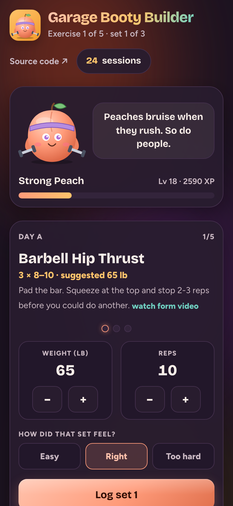
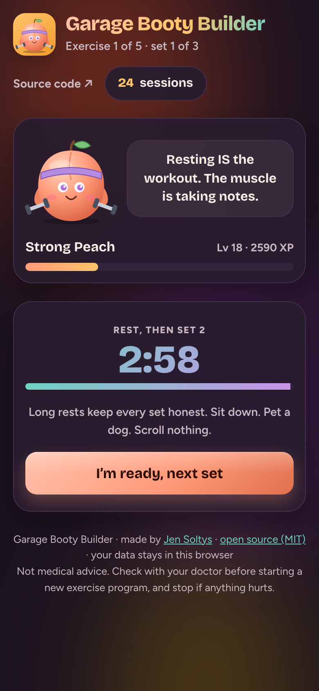
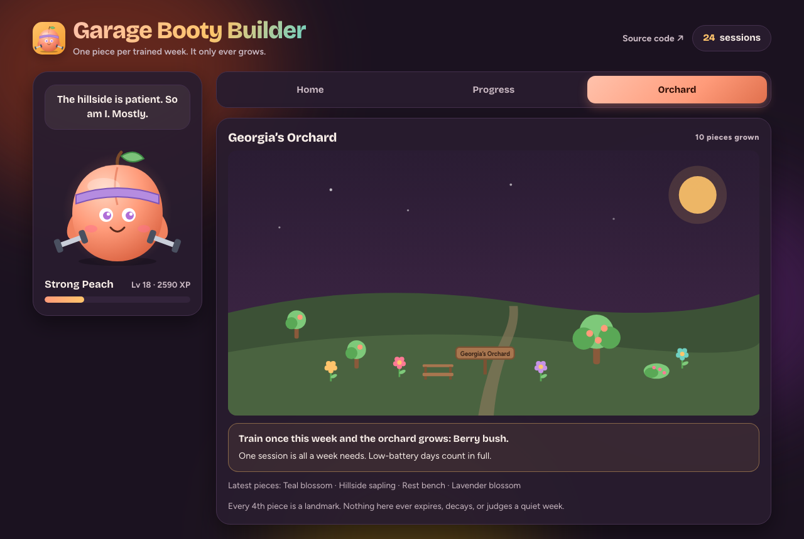
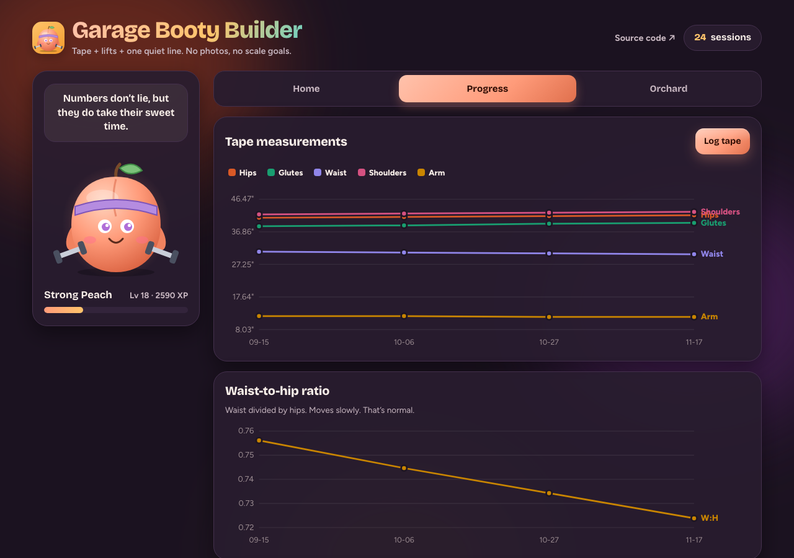

# Garage Booty Builder 🍑

**A game-style home strength tracker that puts recovery first.** It plans each lift, counts your rest, remembers your weights, and cheers you on with Georgia the peach. One static page with no account, no server and no build step. Everything saves in your browser.

**[Try it at jensoltys.github.io/garagebootybuilder](https://jensoltys.github.io/garagebootybuilder/)**. Nothing to sign up for. Or run your own copy with the code in this repo.


---

## What it does

| Part | What you get |
|---|---|
| **Coach** | Tap Start and rate your battery from 1 to 5. It walks you through a 4-minute warm-up, each set with a suggested weight, a rest timer between sets, and a cool-down walk. A 1 or 2 gets a short low-battery session that still counts in full. |
| **Just one exercise** | Same coach, but it asks "One more?" after each exercise. Stopping early still saves a full session, and the day you didn't finish stays next. |
| **Program** | Three lift days, A, B and C, that rotate by the sessions you actually do, not by the calendar, so a missed day never gets skipped. It suggests a rest day after every lift. |
| **Progress** | Tape measurement charts, waist-to-hip ratio, an estimated one-rep max chart for each key lift, a quiet bodyweight line, and your session history. |
| **Quests + XP** | 11 quests, levels every 150 XP, and five Georgia stages from Fresh Peach to Legendary Peach. Strength quests stay locked until week 7, so the first weeks are about showing up. |
| **Georgia's Orchard** | One new piece on the hillside for every week you train, 48 hand-drawn pieces before the wildflowers take over. It only ever grows. |
| **Extras** | A printable one-page checklist for each day, a walk or other-movement log, an easy Mat Day routine, form video links for every move, and backup and restore. |

No streaks anywhere. Missed days don't cost you anything.

<p>


</p>

<p>


</p>

---

## The recovery-first rules

These live in `assets/gbb-today.js` and `app.js`, and they're the heart of the app:

- **Every set stops 2 to 3 reps before failure.** Weights only go up from week 5, after two clean sessions at the top of the rep range with no "Too hard" sets.
- **Weeks 1 and 2 use 2 sets** per exercise. So do deloads and low-battery days.
- **Long rests.** 3 minutes after the first two exercises of a day, 2.5 minutes after the rest.
- **A next-day check.** The day after a lift, it asks how you felt from 1 to 5. Two rough days (2 or less) inside 14 days and it offers a lighter week. Finishing a deload session earns a quest.
- **Every 7th week is a deload** on its own: weights drop to 70% and sets to 2.
- **A rough next day holds your weights** at the earlier session's load instead of pushing them up.

## Use it

1. Open the [try-it page](https://jensoltys.github.io/garagebootybuilder/) on the phone you'll train with.
2. Tap Share, then **Add to Home Screen**, so it opens full screen like an app.
3. Tap **Start today's session**.

Your log lives only in that browser. Each browser keeps its own copy, and clearing your browser data erases it. Use **Save a backup file** on the Progress tab now and then, and **Restore from a backup** to move to a new phone.

Safari can delete a site's saved data after seven days of Safari use without you using that site. The WebKit team, who build Safari's engine, say they don't expect that to happen to a page added to the Home Screen. A backup file covers you either way. Only restore backup files you saved yourself.

The page loads its two fonts from Google Fonts. Nothing else leaves your device.

## Run your own copy

It's plain HTML and JavaScript, so any static host works.

```bash
git clone https://github.com/jensoltys/garagebootybuilder.git
cd garagebootybuilder
npm start        # same as: python3 -m http.server 8000
```

Then open http://localhost:8000. To put your own copy online for free, fork this repo and turn on **Settings > Pages > Deploy from a branch > main**.

### Make the program yours

Everything you'd want to change is in **`program.js`**: the exercises for Day A, B and C, sets, rep ranges, starting weights, weight steps, form cues, pinned form videos, the warm-up and the Mat Day routine. The comments at the top explain each field.

One rule: never rename or reuse an exercise `id` once you've logged sets with it, because your history is keyed by id. Give a new exercise a new id.

Run `npm test` after editing. It checks your program for duplicate ids, empty days, bad numbers and non-https video links.

### What's where

| File | What it holds |
|---|---|
| `index.html` | The page shell and all the styles. It carries a content security policy that only lets this repo's own scripts run. |
| `app.js` | The app: screens, coach, charts, quests, orchard, and the storage layer (search for `data layer`). |
| `program.js` | The training program. Edit this one. |
| `assets/gbb-today.js` | The program rules: which lift is next, program week, deloads, set counts, rest times. Pure functions, no browser needed. |
| `assets/georgia.js` | Georgia the peach, drawn in SVG for each of her five stages. |
| `tests/` | Node tests for the program rules, `program.js`, and bad input from storage or a restore file. |

## Built with

Garage Booty Builder is one static page with plain JavaScript files, hosted on GitHub Pages. There's no server, no account and no build step, and everything saves in your browser.

## Tests

```bash
npm test
```

Node 18.1 or newer, nothing to install. The tests cover the program rules, `program.js`, and how the app handles a damaged or hostile backup file.

## Not medical advice

Garage Booty Builder is a tracker, not a doctor or a coach. Check with your doctor before starting a new exercise program, and stop if anything hurts.

## Made by

**Jen Soltys**. I build small apps that fix everyday annoyances at **[Jen Built It](https://jenbuiltit.com)** and write about building with AI at **[jen8n.com](https://jen8n.com)**.

If Garage Booty Builder helps you, the best support is a ⭐ on this repo.

## Contributing

Bug reports and ideas are welcome in [Issues](../../issues). I'm not taking pull requests right now. You're free to fork it and make it yours under the license below. See [CONTRIBUTING.md](CONTRIBUTING.md), [SUPPORT.md](SUPPORT.md) and the [code of conduct](CODE_OF_CONDUCT.md).

## License

[MIT](LICENSE). Use it, change it, share it. If you publish a changed copy, give it your own name so nobody mistakes it for the original.

YouTube is a trademark of Google LLC. Garage Booty Builder isn't affiliated with or endorsed by Google.
